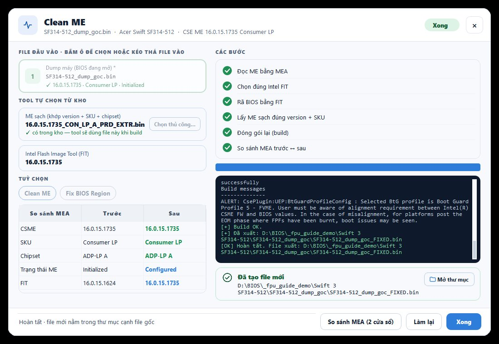

# FPU · Firmware Patch Utility

FPU là bộ công cụ xử lý firmware BIOS cho **kỹ thuật viên sửa chữa laptop ở mức board (board-level)**.
Tool gói gọn trong **một file EXE chạy trên Windows**, tập trung vào các công việc thường gặp khi sửa main:
làm sạch Intel ME và dựng lại BIOS, tách ảnh BIOS chuẩn từ gói cập nhật của hãng, đọc và nạp lại thông tin
máy (DMI / Serial / key Windows), mở khoá — xoá mật khẩu BIOS, cùng các công cụ xử lý firmware Apple
(EFI / T2). Kho ME sạch và FIT được tải tự động theo đúng đời máy đang xử lý, có đối chiếu SHA256.

> Kho GitHub này chỉ chứa **bản phát hành (file EXE)**, không chứa mã nguồn.

## Tải về & cập nhật

Tải **[bản mới nhất tại trang Releases](https://github.com/9xnokiax9/fpu-firmware-patch-utility/releases/latest)**.
Mỗi bản phát hành kèm mã **SHA256** để đối chiếu tính toàn vẹn của file. Khi có phiên bản mới, tool tự hiển thị
thông báo cập nhật.

## Chức năng

### Làm sạch ME và sửa vùng BIOS (Intel)

- **Clean ME** — làm sạch vùng Intel ME bằng ME sạch được **tự chọn đúng phiên bản, SKU và chipset**, cùng
  bản **FIT** gần đời nhất; sau đó rã và đóng gói lại BIOS theo chuẩn Intel Flash Image Tool.
- **Fix BIOS Region** — thay vùng BIOS bằng ảnh BIOS chuẩn của hãng khi vùng BIOS trên máy bị hỏng.
- **Fix ME MFS / EFS** — khi FIT không rã được do MFS/EFS hỏng, tool thay hai phân vùng này từ ME gốc đúng
  phiên bản rồi thử lại.
- **Thay từng phân vùng ME** — so sánh từng phân vùng của $FPT (MFS, EFS, FLOG, FITC…) với ME gốc và cho
  phép thay đúng phân vùng cần sửa.
- **Kiểm tra PMC / PHY** — phát hiện CSE thiếu PMC (nguyên nhân FIT không rã được trên CSME 12 trở lên).
- **Chọn FIT thủ công**, **kiểm tra CPU Microcode**, **tách ME từ BIOS hãng** (dùng cho máy khoá OEM Key).

### Dựng lại BIOS tự động (One-Click theo hãng)

Quy trình một bước từ dump gốc + file hãng ra BIOS mới hoàn chỉnh: **Dell, HP, Lenovo, Acer, Asus, AMD, MSI**.
Hỗ trợ **máy hai chip** (Build Dual Chip, tách BIOS khỏi EC) và **gộp Dual BIOS** (Merge ROM) của Dell.

### Tách BIOS từ gói cập nhật của hãng

Lấy ảnh BIOS chuẩn từ gói cập nhật chính hãng, nhận diện định dạng tự động:

- **Dell** — PFS Extract.
- **HP** — SoftPaq, AMI UCP (Winflash đời cao), capsule.
- **Insyde** — H2OFFT (đa hãng).
- **Acer** — tách Region từ `.zip` / `.exe` / `.fd`.
- **MSI** — tách BIOS từ gói hãng và tách **EC ROM (ENE)**.
- **ASUS** — tách nhanh ảnh AMI, tách đúng BIOS Region kèm so sánh.
- **Gigabyte**, **Microsoft Surface** (gói `.msi`).
- **EC Finder** — bóc vùng EC theo kích thước cửa sổ I/O.

### DMI, Serial và key Windows

- **DMI / Serial** — đọc, sao chép và nạp lại thông tin máy (Serial, SKU, Board, UUID…) theo công cụ riêng
  của từng hãng: HP, Dell (Service Tag), Lenovo (ThinkPad lưu DMI trong chip EC), ASUS, Acer, Gigabyte;
  sửa DMI trong chip EC cho dòng HP AMD.
- **Key Windows OEM (MSDM)** — đọc, sửa và nạp lại key Windows OEM nhúng trong BIOS, hoạt động với nhiều hãng
  nhờ nhận diện theo cấu trúc chuẩn thay vì theo từng hãng.
- **Nạp DMI gốc + key Windows sang BIOS mới** — tuỳ chọn tự chép DMI và key Windows từ dump gốc sang BIOS vừa
  dựng lại, để BIOS mới giữ đúng danh tính máy.

### Mở khoá và xoá mật khẩu BIOS

Hỗ trợ xoá / mở khoá mật khẩu BIOS theo nhiều cơ chế khác nhau tuỳ hãng:

- **HP** — xoá mật khẩu Insyde và mở khoá BIOS.
- **Dell** — xoá mật khẩu (gồm dòng 8FC8 / Dell Pro) và sinh **Master Password** từ mã khoá.
- **Lenovo** — IdeaPad / Yoga; **ThinkPad** (mật khẩu nằm trong chip EC); **ThinkBook / IdeaPad nền AMI**
  (đọc thẳng mật khẩu để nhập vào BIOS).
- **ASUS** (AMITSESetup), **Acer**, **Gigabyte** (chọn CPU Gen 11 / Gen 13).
- **Tự động nhận hãng** — một nút dò và xử lý mật khẩu không cần chọn hãng.

### Apple MacBook (EFI / T2)

Đọc và sửa dump firmware Apple: **gỡ EFI Lock**, đổi serial, thay / sửa Fsys, xoá NVRAM, thay vùng ME (tự chọn
ME sạch đúng model). Kèm **kho ROM gốc** cho chip USB-C (CD3215 / CD3217) và dữ liệu T2 theo model, mã main và
vị trí IC.

### Công cụ phân tích và sửa lỗi khác

- **So sánh checksum** nhiều lần dump cùng chip để phát hiện dump lỗi / thiếu byte.
- **Fix TPM** (bật Intel PTT), **Disable RAM onboard** (xoá SPD), **tráo Region trực tiếp** (IFD splice, không
  cần FIT).
- **Surface** — khắc phục mất cảm ứng sau khi làm sạch ME (ISH).
- **Tra cứu BIOS hãng** — tìm nhanh trang tải BIOS theo model / mã main.

### Hỗ trợ theo hãng

| Hãng | Dựng lại BIOS | Tách từ gói hãng | DMI / Serial | Mật khẩu BIOS |
|---|:-:|:-:|:-:|:-:|
| HP | ✓ | ✓ | ✓ | ✓ |
| Dell | ✓ | ✓ | ✓ | ✓ |
| Lenovo | ✓ | ✓ | ✓ | ✓ |
| ASUS | ✓ | ✓ | ✓ | ✓ |
| Acer | ✓ | ✓ | ✓ | ✓ |
| Gigabyte | ✓ | – | ✓ | ✓ |
| MSI | ✓ | ✓ | – | – |
| Microsoft Surface | – | ✓ | – | – |
| Apple MacBook | EFI / T2 | – | ✓ (serial) | EFI Lock |

## Hình ảnh

Hướng dẫn từng bước đầy đủ tại **https://fpu.mac68.vn/huong-dan**.

 Màn hình chính sau khi thả BIOS (serial đã che)

|  Clean ME — bảng so sánh trước và sau |  So sánh checksum dump |
|:-:|:-:|

|  DMI / Thông tin máy |  Tách BIOS đa hãng |
|:-:|:-:|

## Yêu cầu và cài đặt

1. Windows 10 / 11 bản 64-bit.
2. Chỉ cần **một file `FPU_V*.exe`** — chép vào đâu cũng chạy. Bộ công cụ nền (MEA, các bộ tách BIOS, PMC / PHY)
   nằm sẵn trong EXE, lần đầu mở tự cài trong vài giây (chỉ một lần).
3. Lần đầu chạy, Windows SmartScreen có thể hỏi — chọn **More info → Run anyway**.

Kho **ME sạch** và **FIT** được tải tự động từ máy chủ khi cần, chỉ tải đúng phần phù hợp với phiên bản ME của
BIOS đang xử lý và có kiểm tra SHA256.

## Báo lỗi

Gặp lỗi, bấm nút **Báo lỗi** trong tool: mô tả lỗi và để lại liên hệ (không bắt buộc). Tool đính kèm nhật ký xử
lý và — nếu bạn đồng ý — file BIOS đang mở, giúp tái hiện và sửa lỗi nhanh nhất.

## Câu hỏi thường gặp

- **Thiếu FIT / ME cho một đời máy?** Kết nối mạng để tool tự tải phần kho cần dùng; nếu kho máy chủ chưa có,
  gửi **Báo lỗi** kèm file BIOS.
- **Key Windows / mật khẩu không hiện?** Mỗi hãng lưu dữ liệu ở vị trí khác nhau — hãy dùng đúng công cụ của
  hãng tương ứng; nếu vẫn chưa ra, gửi **Báo lỗi** kèm dump để bổ sung hỗ trợ cho đời máy đó.

## Lịch sử cập nhật

Xem ghi chú từng phiên bản tại trang **[Releases](https://github.com/9xnokiax9/fpu-firmware-patch-utility/releases)**.

---

Tham khảo và ghi nhận: [Mac68.Vn](https://mac68.vn) · [Win-Raid](https://winraid.level1techs.com/) · [Badcaps](https://www.badcaps.net/) · [Chính sách quyền riêng tư](https://fpu.mac68.vn/privacy)
