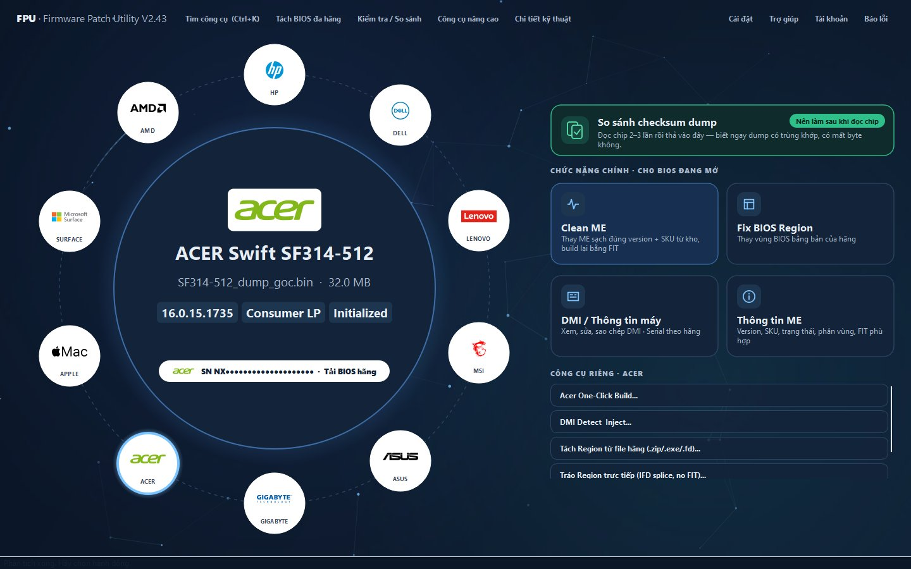
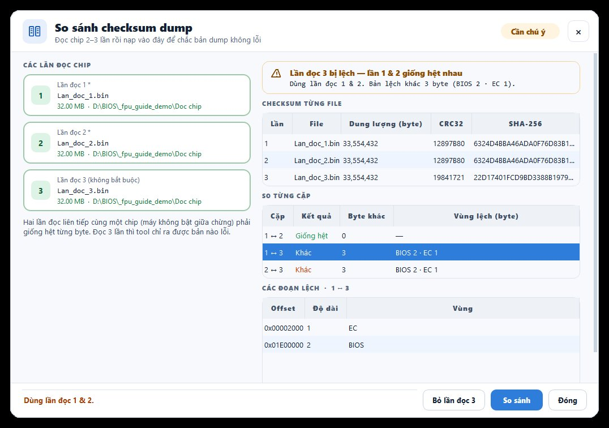
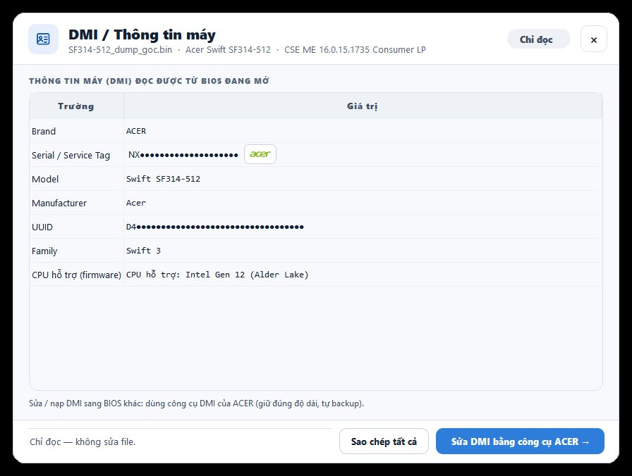
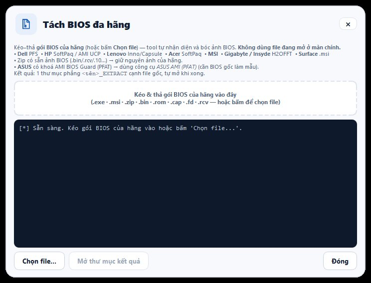

# FPU · Firmware Patch Utility

Bộ công cụ xử lý BIOS dành cho **kỹ thuật viên sửa chữa laptop** — làm sạch ME, thay vùng BIOS của hãng,
rã / đóng gói lại BIOS, tách BIOS từ gói cập nhật, đọc / nạp DMI, mở khoá mật khẩu BIOS.

> Repo này chỉ chứa **bản phát hành (file EXE)**, không chứa mã nguồn.

## ⬇️ Tải về

**[Tải bản mới nhất](https://github.com/9xnokiax9/fpu-firmware-patch-utility/releases/latest)** — mỗi bản phát hành kèm
mã **SHA256** để đối chiếu file. Tool tự báo khi có phiên bản mới (popup cập nhật).

## ✨ Chức năng

| Nhóm | Mô tả |
|---|---|
| **Clean ME & Fix Region** | Làm sạch ME, thay vùng BIOS của hãng, rã và đóng gói lại BIOS (Intel FIT). Tự chọn ME sạch đúng SKU / chipset và FIT gần đời nhất; ME rã lỗi → tự thay MFS + EFS rồi thử lại. Thay từng phân vùng ME (MFS, EFS, FLOG…) so với ME gốc. |
| **Build BIOS tự động** | One-Click theo hãng: Dell, HP, Lenovo, Acer, Asus, AMD; hỗ trợ máy 2 chip. |
| **Tách BIOS đa hãng** | Lấy ảnh BIOS chuẩn từ gói cập nhật của hãng (Dell PFS, HP SoftPaq / AMI UCP, Lenovo, Acer, MSI, Insyde, Gigabyte, ASUS, Surface…). |
| **Tra cứu BIOS hãng** | Tìm nhanh gói BIOS theo model / mã main. |
| **Apple MacBook** | Mac EFI / T2: đọc dump, gỡ EFI Lock, đổi serial, thay / sửa Fsys, xoá NVRAM, thay vùng ME (tự chọn ME sạch đúng model). Kho ROM gốc chip USB-C (CD3215 / CD3217) và dữ liệu T2 theo model, mã main, vị trí IC. |
| **DMI / Serial** | Đọc, sao chép và nạp lại thông tin máy. |
| **Mở khoá mật khẩu BIOS** | Hỗ trợ nhiều hãng (HP, Dell, Lenovo, ASUS, Acer, Gigabyte…). |
| **Kiểm tra & so sánh** | Đối chiếu BIOS gốc với BIOS đã xử lý. |
| **Công cụ nâng cao** | Fix TPM (Intel PTT), Disable RAM onboard, tráo Region trực tiếp. |

## 📸 Hình ảnh hướng dẫn

Xem đầy đủ từng bước tại **https://fpu.mac68.vn/huong-dan**.

 Màn hình chính sau khi thả BIOS (serial đã che)

|  Clean ME — bảng so sánh MEA trước ↔ sau |  So sánh checksum dump |
|:-:|:-:|

|  DMI / Thông tin máy |  Tách BIOS đa hãng |
|:-:|:-:|

## 🧰 Cài đặt

1. Windows 10 / 11 bản 64-bit.
2. Chỉ cần **1 file `FPU_V*.exe`** — chép vào đâu cũng chạy. Bộ công cụ (MEA, công cụ tách BIOS, PMC/PHY)
   nằm sẵn trong EXE, lần đầu mở tự cài vào `%LOCALAPPDATA%\FPU-FirmwarePatchUtility` (vài giây, chỉ một lần).
3. Chạy file EXE (lần đầu Windows SmartScreen có thể hỏi — chọn *More info → Run anyway*).

Kho dữ liệu **ME sạch (CleanME) + FIT** được tool **tự tải từ máy chủ** khi cần — chỉ tải đúng phần
phù hợp với phiên bản ME của BIOS đang xử lý, có kiểm tra SHA256.

## 🔐 Đăng nhập

1. Mở tool → bấm **Đăng nhập Google** → chọn tài khoản Google của bạn trên trình duyệt.
2. Nút **Tài khoản** (thanh bên trái): họ tên, Gmail, hạn dùng, đăng xuất / đổi tài khoản.

## 🐞 Báo lỗi

Gặp lỗi? Bấm nút **Báo lỗi** ở thanh bên trái: mô tả lỗi, để lại Zalo / SĐT (không bắt buộc). Tool tự gửi kèm
nhật ký xử lý và — nếu bạn đồng ý — file BIOS đang mở, giúp tái hiện và sửa lỗi nhanh nhất.

## ❓ Câu hỏi thường gặp

- **Không mở được trình duyệt khi đăng nhập?** Kiểm tra trình duyệt mặc định của Windows, rồi bấm Đăng nhập Google lại.
- **Thiếu FIT / ME cho một đời máy?** Kết nối mạng — tool tự tải phần kho cần dùng; nếu kho máy chủ chưa có, gửi *Báo lỗi* kèm file BIOS.

## 📝 Lịch sử cập nhật

Xem ghi chú từng phiên bản ở trang **[Releases](https://github.com/9xnokiax9/fpu-firmware-patch-utility/releases)**.

---

Tham khảo & ghi nhận: [Mac68.Vn](https://mac68.vn) · [Win-Raid](https://winraid.level1techs.com/) · [Badcaps](https://www.badcaps.net/) · [Chính sách quyền riêng tư](https://fpu.mac68.vn/privacy)
